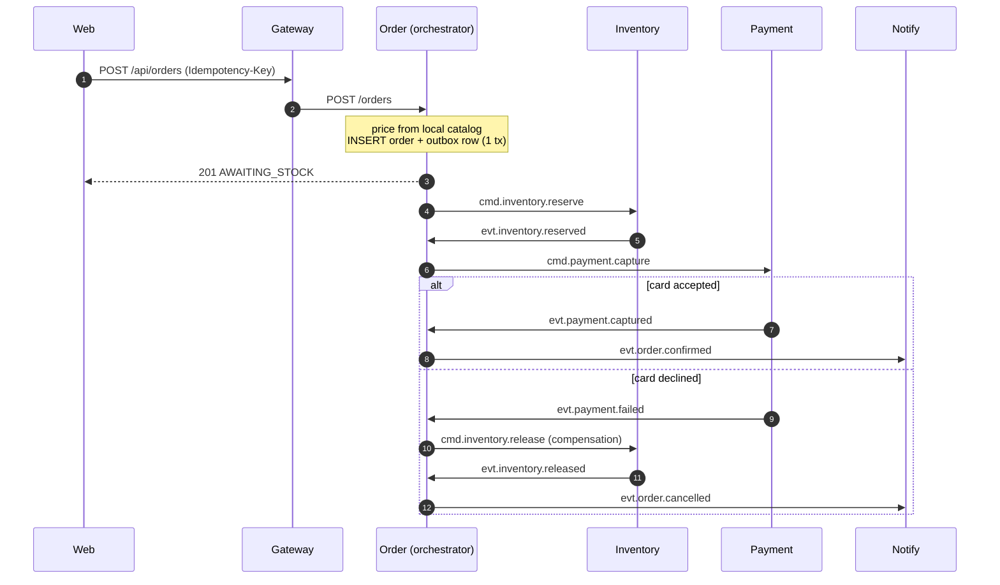
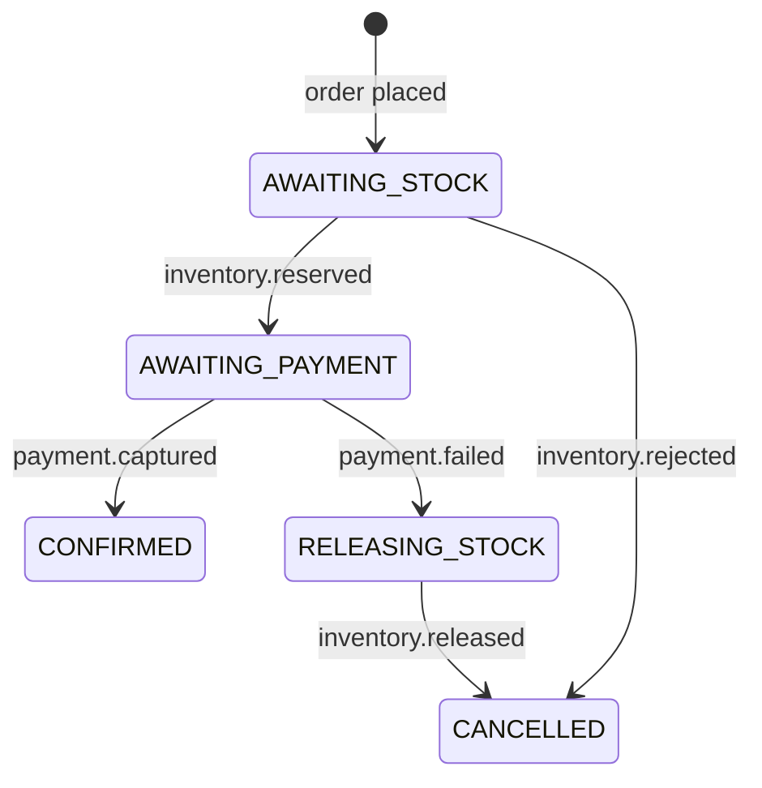

# Checkout Saga

An event-driven checkout built as five small services that keep their data consistent without a distributed transaction. Every order runs as an **orchestrated saga** over **NATS JetStream**. Messages go out through a **transactional outbox** and are deduplicated by a per-consumer **inbox**. One **OpenTelemetry** trace follows each order across every hop, and the web UI draws those traces live.

    

## What happens when you click "Checkout"



Every arrow after step 3 is a JetStream message written to an outbox table first. The HTTP request returns as soon as the order row is committed. The rest of the saga runs asynchronously, and the UI follows it through the trace stream.

### Saga states



The state machine is a pure function, `transition(saga, event) → { saga, messages }`, in [`apps/order/src/saga`](apps/order/src/saga) and is unit-tested with no I/O. [`saga.runner.ts`](apps/order/src/saga/saga.runner.ts) is the thin shell around it. It loads the order with `SELECT … FOR UPDATE`, calls `transition`, and in one transaction stores the new state, an audit row and the next commands.

## Services

| Service | Owns | Does |
|---|---|---|
| **gateway** | nothing | Public HTTP API and BFF, validation, per-IP rate limit, serves the web build, proxies the trace stream |
| **order** | `orders` schema: orders, transitions, catalog replica | Saga orchestrator. Prices orders from its local catalog copy |
| **inventory** | `inventory` schema: products, stock, reservations | Reserves and releases stock all-or-nothing. Owns and publishes the catalog |
| **payment** | `payments` schema | Fake card provider with a $500 limit (the decline path). Payment is the pivot step, so it never needs a refund |
| **notify** | `notify` schema | Sends "e-mails" on confirmed or cancelled orders. It is **outside** the saga: a failed e-mail can't cancel a paid order |
| **trace-relay** | in-memory ring buffer | Receives OTLP/HTTP JSON spans and fans them out to browsers over SSE |

Shared code lives in [`libs/`](libs): `contracts` (zod schemas for every message and HTTP shape), `messaging` (streams, outbox relay, consumer runner, inbox, DB bootstrap) and `telemetry` (OTel setup, propagation helpers, HTTP tracing middleware).

## Guarantees, and how they are kept

| Problem | Answer | Where |
|---|---|---|
| Write to DB, then crash before publishing | Transactional outbox: state and message commit together, and a relay publishes afterwards | [`relay.ts`](libs/messaging/src/relay.ts) |
| Relay publishes, then crashes before marking the row | JetStream dedupe on `msgID = outbox.id` (2 min window), with the inbox behind it | [`nats.ts`](libs/messaging/src/nats.ts) |
| A message is delivered twice | Each consumer inserts `(message_id, consumer)` into its inbox in the same transaction as its side effects | [`outbox.ts`](libs/messaging/src/outbox.ts) `claimMessage` |
| Two buyers, one item | `SELECT … FOR UPDATE` on product rows, locked in sku order (no deadlocks), plus a `CHECK (stock >= 0)` | [`stock.handler.ts`](apps/inventory/src/stock/stock.handler.ts) |
| Client retries a POST | `Idempotency-Key` header, enforced by a unique column | [`orders.service.ts`](apps/order/src/orders/orders.service.ts) |
| Client sends a fake price | The client sends only sku + quantity. The price comes from the server's catalog | same |
| A service is down | Durable pull consumers: messages wait in JetStream and the saga resumes when the service comes back | try `docker compose stop payment` |
| A message that can never succeed | Fails schema validation → `term()`. Other errors → `nak()` with backoff, up to `max_deliver` | [`consumer.ts`](libs/messaging/src/consumer.ts) |

## Tracing across async hops

When a service writes an outbox row it also stores the current W3C `traceparent` in `outbox.headers`. The relay restores that context, opens a `PRODUCER` span and puts the header on the NATS message. The consumer opens a `CONSUMER` span whose parent is that producer span. So the HTTP request, five services and the async gaps between them form one trace. The gateway starts traces only for writes (`POST`/`PATCH`), and internal services only continue traces they receive. That keeps the UI's polling out of the picture.

## Run it

Requirements: Docker, Node 24, pnpm 11.

```bash
pnpm install
pnpm up            # builds one image, starts Postgres, NATS and all services
open http://localhost:8080
pnpm e2e           # end-to-end check of every saga path against the running stack
```

To develop with hot reload, run only the infrastructure in Docker:

```bash
pnpm infra-up      # Postgres :5433, NATS :4222 (monitoring :8222)
pnpm dev           # builds libs, then watches every service and the web app
open http://localhost:5173
```

Other scripts: `pnpm test` (saga unit tests), `pnpm logs`, `pnpm down`, `pnpm reset` (also deletes volumes).

Things to try:

- `docker compose -f infra/docker-compose.yaml stop payment`, place an order (it waits in *Awaiting payment*), then `start payment` and watch it finish.
- `PAYMENT_RANDOM_FAILURE_RATE=0.3 pnpm up` to see random declines and compensations.
- `curl -X PATCH localhost:8080/api/products/mug -H 'content-type: application/json' -d '{"price":1500}'`. The order service's catalog copy picks up the new price within milliseconds.

## Deploying on one VPS

The whole stack idles at about 370 MB of RAM (Node services about 50 MB each, NATS about 10 MB, Postgres about 35 MB), and every container has a memory limit. Put a TLS proxy such as Caddy in front of `:8080`, and disable response buffering for `/api/stream` (Server-Sent Events). The gateway already sends `X-Accel-Buffering: no` for nginx. Only the gateway port needs to be public. In production, remove the `ports:` entries for `db` and `nats`.

## Decisions

Architecture decision records live in [`docs/adr`](docs/adr):

1. [Orchestration over choreography](docs/adr/0001-orchestrated-saga.md)
2. [Transactional outbox and inbox](docs/adr/0002-outbox-and-inbox.md)
3. [JetStream stream layout](docs/adr/0003-jetstream-streams.md)
4. [Catalog read model in the order service](docs/adr/0004-catalog-read-model.md)
5. [Live tracing through a custom relay](docs/adr/0005-live-tracing.md)

## Known limits

- **No saga timeouts.** A saga waits as long as a service is down. That is correct here because every step eventually answers, but a real system would add deadlines and a "stuck sagas" view.
- **One relay loop per service instance.** `FOR UPDATE SKIP LOCKED` makes extra instances safe, but strict global ordering across instances isn't guaranteed. The saga doesn't need it, because each saga waits for one reply at a time.
- **Inbox rows are never pruned.** A nightly `DELETE … WHERE processed_at < now() - interval '7 days'` (matching stream retention) would fix that.
- **trace-relay is in-memory.** Restarting it forgets old traces. That's fine for a live view, but use Tempo or Jaeger for history.

## Layout

```
apps/
  gateway/       public API + static web
  order/         saga orchestrator (pure state machine in src/saga)
  inventory/     stock, reservations, catalog owner
  payment/       fake card provider
  notify/        e-mails, outside the saga
  trace-relay/   OTLP → SSE
  web/           React + React Flow UI
libs/
  contracts/     zod schemas for messages and HTTP
  messaging/     JetStream, outbox relay, inbox, consumers, DB bootstrap
  telemetry/     OpenTelemetry setup and propagation
infra/           docker compose
docs/adr/        decision records
scripts/e2e.mjs  end-to-end check
```
